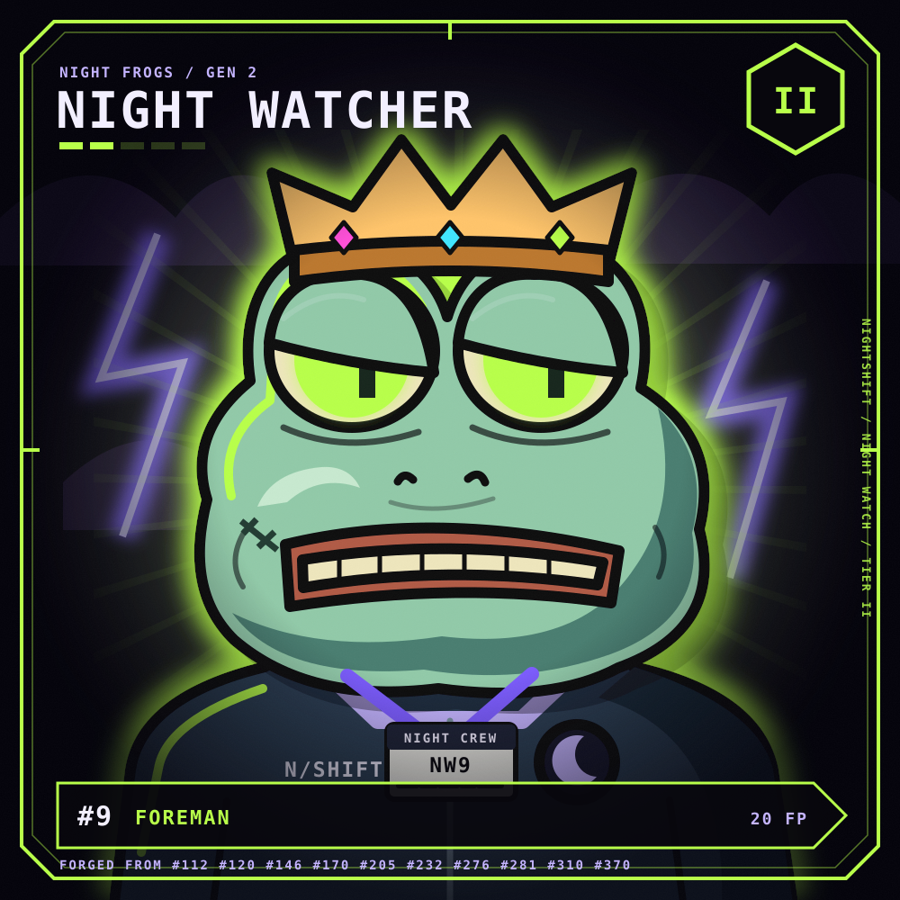

# NightWatchRenderer

An immutable, stateless Ethereum renderer for **NIGHT WATCHERS**. The sole callable
function is `svg(...)`. It composes the requested SVG from the existing NIGHT FROGS
artwork and the watcher's supplied attributes. It does not mint or manage NFTs.

**Status:** implemented and tested locally, including all five supplied keccak256
vectors. The five previews below are exact contract outputs. Mainnet deployment
and Etherscan/Sourcify verification are the IMD launch service's post-acceptance
steps; this repository does not claim a deployed renderer address.

## Contract and behavior

Application: [`src/NightWatchRenderer.sol`](src/NightWatchRenderer.sol), Solidity
name `NightWatchRenderer`.

```solidity
function svg(
    uint256 n,
    uint8 t,
    uint8[7] calldata traits,
    string calldata label,
    uint16[10] calldata inputs,
    uint16 points
) external view returns (string memory);
```

Selector: `0xa710dfca`. Every caller receives the same result for the same
arguments and dependency responses. Tier 0 and tiers above 6 revert with
`InvalidTier(uint8)`, before any external call. Tier 6 is The Captain. Number zero
is valid, as in the Captain vector. The full `uint256` number and `uint16` input
and point ranges are supported, including zero and maximum values.

There is no owner, admin, storage, initializer, token, fee, upgrade, pause,
fallback, receive function, or payable entry point. There are no constructor
arguments or initialization calls. Direct ETH transfers, unknown selectors, and
calls carrying ETH revert. Ethereum can forcibly credit an address without
executing its code; forced ETH cannot be prevented or recovered by this contract.

The renderer's only external calls are `STATICCALL`s to these fixed addresses:

| Dependency | Ethereum address | Reads |
| --- | --- | --- |
| NIGHT FROGS renderer | `0x4D9BfbafE31eC18E9D3066F1475e24906d155D67` | `traitSVG(uint8,uint8)` once for each layer 0–6 |
| ArtStore | `0x2A0140BC2b117ffEe9b092af1a927b96328FB000` | `read(uint256)` at 0 for every render; at 3 only for tier 6 |

Dependency failures propagate. The renderer does not replace missing artwork or
silently change trait indices. The upstream renderer and stores themselves access
their existing on-chain art data contracts; these are included in the offline
snapshot. There are no runtime HTTP, oracle, or other off-chain service calls.

The supplied concatenation is preserved byte for byte, including existing
whitespace in external artwork. `label` is inserted **verbatim**, with no escaping,
normalization, or length limit. Trait indices, source numbers, duplicates, labels,
and points are presentation inputs: this renderer does not authenticate NFT
ownership, forging eligibility, scores, or uniqueness. The separately ordered NFT
must enforce its own rules. Integrators must use trusted labels or isolate
untrusted SVG content. Long labels can increase rendering cost, and very large
numbers or labels can overflow the visual plate even though the required bytes
remain correct.

## Build and test offline

Foundry and Solidity **0.8.26** must already be installed. All project dependencies
are ordinary files under `lib/`; no package download, submodule, fork, RPC access,
test environment variables, FFI, or write filesystem permissions are needed.
Tests only read the committed snapshot, vector definitions, and previews.

```sh
forge build
FOUNDRY_FUZZ_SEED=0x8722dd41e9b06c1fcb1e0ba7f8f4c474496ed13e520f2f93221c331e47865edd forge test
forge fmt --check
```

The suite contains 31 tests, including four fuzz tests with 256 runs each. It
checks the five exact hashes and preview bytes, all six tier thresholds, layer
ordering, rotations, ember counts and endpoints, badges, all caller identities,
decimal formatting, zero/max values, raw labels, source ordering, invalid tiers,
missing/malformed/reverting dependencies, static-call enforcement, no renderer
storage access, empty-chain construction, and rejected ETH/unknown calls.

`test/fixtures/mainnet.json` captures actual deployed bytecode and raw call results
from Ethereum block **26,244,666**, timestamp **2026-10-22 00:48:23 UTC**, block hash
`0x46d320f859609fbc3387ea8fea949cc8e97c34b8648d18532b1f76a189de921a`.
The tests restore five accounts and run their real code, without mock responses
for the vectors. A separate test reproduces every one of the 25 recorded calls.
The accessed dependencies required no storage slots at this block. Capture
provenance and limitations are in [`test/fixtures/README.md`](test/fixtures/README.md).

To reproduce previews from the existing offline snapshot:

```sh
python3 tools/export_examples.py
```

This runs the local-only `script/RenderExamples.s.sol`, validates the hashes, and
exports the contract's output bytes. It does not broadcast. Refreshing the snapshot
is an explicit, optional development operation requiring a public Ethereum RPC:

```sh
python3 tools/capture_fixture.py --rpc https://ethereum-rpc.publicnode.com --block 26244666
```

## Gas and deployment parameters

Measured with Foundry 1.8.3, solc 0.8.26, the committed configuration, and the real
dependency bytecode restored from the snapshot:

| Vector | Tier | SVG bytes | Measured rendering gas |
| --- | ---: | ---: | ---: |
| #1 SHIFT LEAD | 1 | 15,920 | 131,589 |
| #9 FOREMAN | 2 | 10,536 | 111,359 |
| #7 SUPERVISOR | 3 | 14,150 | 151,623 |
| #50 KODES | 5 | 16,725 | 213,151 |
| #0 CAPTAIN | 6 | 18,768 | 252,181 |

Reproduce with `forge test --match-test 'test_gas.*Cold' -vv`. These are `gasleft()`
deltas around one external render, including caller ABI encoding/decoding and
return-data copying, with the renderer and all dependency accounts explicitly
cooled. Each vector has its own test invocation. Fixture setup, assertions, and
transaction intrinsic gas are excluded. Each benchmark asserts a 1,000,000-gas
regression ceiling; this is a test budget, not an input restriction or fee. Gas
varies with trait SVG length and caller inputs. An RPC `eth_call` does not charge
the caller ETH; another contract invoking `svg` consumes transaction gas.

| Deployment setting | Value |
| --- | --- |
| Chain | Ethereum mainnet, chain id 1 |
| Deployable application | `src/NightWatchRenderer.sol:NightWatchRenderer` |
| Constructor arguments | None (`[]`; empty ABI suffix) |
| Deployment ETH value | 0 |
| Owner / roles / recipients | None |
| Compiler | `0.8.26+commit.8a97fa7a` |
| Optimizer | Enabled, 200 runs |
| IR pipeline | Enabled (`via_ir = true`) |
| EVM target | Cancun |
| Metadata bytecode hash | `none` |
| Runtime size | 11,772 bytes (EIP-170 limit: 24,576) |
| Creation bytecode size | 11,798 bytes |
| Linked libraries / immutables | None |
| Post-deployment setters | None |

Runtime keccak256:
`0xf482ddd6347255a296996e529e55b89443ecb357e9897a7ab1a07a9436513b9b`.
Creation bytecode keccak256:
`0xa1727883edf3abe6445e8776dca0fc43ebfd77ce7799334208d35f4827e8015b`.
The optimizer and IR settings keep the literal artwork composition comfortably
within the deployment limit. Construction succeeds without the dependencies
present and does not call other contracts.

## After launch

The IMD launch service supplies the manifest, factory deployment, confirmed
renderer address, and creation transaction. Only `NightWatchRenderer` is an
application; test doubles, fixtures, interfaces, and the preview script are not
launch contracts. No owner argument, funding, approval, or initialization is
needed. No `launch.json` is authored in this build assignment.

The deployer should compare the confirmed runtime with
`forge inspect NightWatchRenderer deployedBytecode`, execute the five vectors on
the confirmed address, and publish verification results on both explorers. For
the commands below, `WATCHER_ADDRESS` and `DEPLOYMENT_TX_HASH` are the actual launch
receipt values, and `ETHERSCAN_API_KEY` is supplied by the verification operator.
These names are operational inputs, not addresses or credentials stored in this
repository. Run from this repository with its unchanged compiler configuration:

```sh
forge verify-contract "$WATCHER_ADDRESS" src/NightWatchRenderer.sol:NightWatchRenderer \
  --chain 1 --compiler-version v0.8.26+commit.8a97fa7a \
  --verifier etherscan --etherscan-api-key "$ETHERSCAN_API_KEY" --watch

forge verify-contract "$WATCHER_ADDRESS" src/NightWatchRenderer.sol:NightWatchRenderer \
  --chain 1 --compiler-version v0.8.26+commit.8a97fa7a \
  --verifier sourcify --creation-transaction-hash "$DEPLOYMENT_TX_HASH" --watch
```

These are source-verification submissions, not deployment transactions. Keep the
compiler settings, source path, and source contents intact. See the official
[Etherscan Foundry instructions](https://docs.etherscan.io/contract-verification/verify-with-foundry)
and [Sourcify Foundry instructions](https://docs.sourcify.dev/docs/verify-via-foundry/).
If a verifier client is incompatible with its service, export Standard JSON with
`forge verify-contract "$WATCHER_ADDRESS" src/NightWatchRenderer.sol:NightWatchRenderer --show-standard-json-input`
and submit through the verifier's UI with the same settings. Record the actual
verification status and links after successful submissions.

There is no recurring operator task, keeper, key, treasury, or administration for
this contract. NFT integration, input authenticity, SVG display isolation, and
any future replacement renderer belong to the NFT/integration operator. This
deployment itself cannot be edited or redirected. See the focused
[security review](docs/security-review.md) for tested boundaries and limitations.

## The five images

SVG files retain the exact returned bytes and animation elements. A Markdown
viewer may display a static frame; open the linked SVG directly to see animation.
The full arguments and expected hashes are in
[`test/fixtures/vectors.json`](test/fixtures/vectors.json).

**#1 — SHIFT LEAD, tier I**



**#9 — FOREMAN, tier II**



**#7 — SUPERVISOR, tier III**



**#50 — KODES, tier V**



**#0 — CAPTAIN, tier C**


